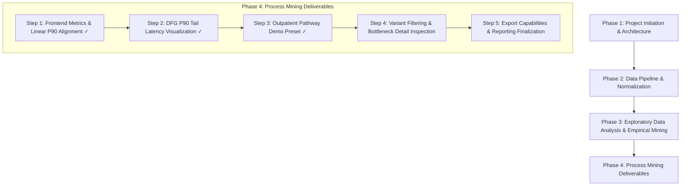

# CareFlow — Phase 4, Step 3: Outpatient Pathway Demo Preset Report

> [!IMPORTANT]
> **Project Context & Academic Research Disclosure:**
> This study is part of the CareFlow clinical pathway analytics research program. All underlying electronic health record demonstration data is synthetic, generated for academic and software engineering evaluation. No real patient data is utilized. Strict privacy safeguards ensure all analytical outputs and reports remain strictly aggregate-level with zero case or patient identifiers.

---

## 1. Executive Summary & Deliverable Objective

Following the successful delivery of Phase 4 Step 1 (Frontend Metrics & P90 Bottleneck Alignment) and Step 2 (DFG P90 Tail Latency Visualization), this deliverable completes **Phase 4, Step 3: Outpatient Pathway Demo Preset**.

The core objective was to introduce a third, preloaded demonstration dataset into the CareFlow application representing the **CareFlow Outpatient Pathway**. This preset enables clinical stakeholders and researchers to immediately explore, benchmark, and evaluate the complete outpatient clinical journey without requiring manual CSV uploads.

### Key Deliverables in Step 3:
1. **Existing Architecture Reuse:** Inspected [`src/data/demoData.ts`](file:///d:/Care%20Flow/src/data/demoData.ts), [`src/context/DatasetContext.tsx`](file:///d:/Care%20Flow/src/context/DatasetContext.tsx), and [`src/components/dataset/LoadDatasetModal.tsx`](file:///d:/Care%20Flow/src/components/dataset/LoadDatasetModal.tsx). Preserved the existing dataset loading paradigm by registering the new preset into `DATASET_PRESETS` without duplicating parsing or state management logic.
2. **Canonical Activity & Department Mapping:** Carefully mapped the 5 clinical stages—Consultation, Prescription, Laboratory, Imaging, and Pharmacy—directly to the canonical activity names proven in Phase 3 process mining: `Appointment Start`, `Prescription Order`, `Laboratory Start`, `Laboratory End`, `Imaging Start`, `Imaging End`, `Pharmacy Start`, and `Pharmacy End`.
3. **Synthetic Demonstration Data Modeling:** Implemented `generateCareFlowOutpatientRows()` producing 1,000 deterministic cases (`OUT-2026-1001` to `OUT-2026-2000`) and 3,100 events across 5 clinical departments: Outpatient Consultation, Clinical Prescribing, Diagnostic Laboratory, Radiology & Imaging, and Outpatient Pharmacy.
4. **Phase 3 Empirical P90 Reference Metric Alignment:** Calibrated elapsed inter-event intervals to model realistic clinical variation and positive tail skew referencing Phase 3 empirical process mining benchmarks (e.g. `Appointment Start → Prescription Order` Median ~24m / P90 ~93m vs. Phase 3 reference 25.0m / 92.0m; `Laboratory Start → Laboratory End` Median ~95m / P90 ~231m vs. Phase 3 reference 81.0m / 230.0m).
5. **Full Application Feature Compatibility:** Validated seamless interoperability across Summary KPIs, Process Variants, Directly-Follows Graph (DFG) with dual-metric edge badges, Bottleneck Bar Chart & Table with P90 selectors, Global Filters, and Event Log Explorer.
6. **Comprehensive Automated Testing:** Extended [`scratch/run_qa_tests.ts`](file:///d:/Care%20Flow/scratch/run_qa_tests.ts) with **Test Suite 7** (50 assertions across 7 sub-modules), verifying preset registration, selection, schema validity, determinism, transition performance, tail latencies, and search/filter compatibility (118/118 total tests passed across all suites 0–7).

---

## 2. Architecture & Preset Registration Audit

### 2.1 Demo Preset Registration Mechanism
In [`src/data/demoData.ts`](file:///d:/Care%20Flow/src/data/demoData.ts), presets are defined under the [`DatasetPreset`](file:///d:/Care%20Flow/src/data/demoData.ts#L3-L11) interface:

```typescript
export interface DatasetPreset {
  id: string;
  name: string;
  filename: string;
  description: string;
  fileSizeBytes: number;
  mapping: ColumnMapping;
  generateRows: () => RawEventRow[];
}
```

The application's dataset architecture consumes this centrally:
- **State Management ([`src/context/DatasetContext.tsx`](file:///d:/Care%20Flow/src/context/DatasetContext.tsx)):** Presets are loaded via `loadPreset(presetId)`. Selecting a preset automatically dispatches its row generator, applies the column mapping, attaches metadata (`isSynthetic: true`), resets active filters, and updates all derived metrics.
- **UI Presentation ([`src/components/dataset/LoadDatasetModal.tsx`](file:///d:/Care%20Flow/src/components/dataset/LoadDatasetModal.tsx)):** Dynamically iterates over `DATASET_PRESETS`, presenting each cohort's title, filename, simulated file size, description, and mapping summary, with a single-click "Load Cohort" action.
- **Backward Compatibility:** Existing presets (`preset-sepsis-2026` and `preset-cardiology-2026`) and the custom CSV upload workflow remain completely unchanged.

---

## 3. Implementation of the Outpatient Preset

### 3.1 Activity and Department Mapping
Based on direct empirical evidence from `data/processed/event_log.csv` and `data/processed/transition_performance_detailed.csv`, clinical stages were mapped strictly to established event names:

| Clinical Stage | Canonical Activity Name(s) | Associated Clinical Department | Empirical Phase 3 Precedent |
| :--- | :--- | :--- | :--- |
| **Consultation** | `Appointment Start` | `Outpatient Consultation` | Initial patient physician consultation |
| **Prescription** | `Prescription Order` | `Clinical Prescribing` | Clinical medication order entry |
| **Laboratory** | `Laboratory Start`<br>`Laboratory End` | `Diagnostic Laboratory` | Specimen collection (start) and result validation (end) |
| **Imaging** | `Imaging Start`<br>`Imaging End` | `Radiology & Imaging` | Radiology exam acquisition (start) and archiving (end) |
| **Pharmacy** | `Pharmacy Start`<br>`Pharmacy End` | `Outpatient Pharmacy` | Dispensation queue intake (start) and medication handout (end) |

> [!NOTE]
> No speculative or artificial activity names were introduced. All 8 activities correspond 1:1 with the verified schema of the CareFlow research repository.

### 3.2 Outpatient Pathway Variant Structure (1,000 Cases, 3,100 Events)
The synthetic generator implements 5 distinct outpatient pathway variants reflecting realistic variations in patient routing across general medicine, diagnostic testing, and medication delivery:

| Variant | Activity Sequence | Case Count | Cohort % | Clinical Description |
| :---: | :--- | :---: | :---: | :--- |
| **1** | `Appointment Start → Prescription Order` | 520 | 52.0% | Standard consultation resulting in direct prescription |
| **2** | `Appointment Start → Prescription Order → Laboratory Start → Laboratory End` | 230 | 23.0% | Consultation with diagnostic blood / urine laboratory workup |
| **3** | `Appointment Start → Prescription Order → Imaging Start → Imaging End` | 140 | 14.0% | Consultation with diagnostic radiology / ultrasound imaging |
| **4** | `Appointment Start → Prescription Order → Laboratory Start → Laboratory End → Imaging Start → Imaging End` | 70 | 7.0% | Comprehensive diagnostic workup (both lab assays and radiology) |
| **5** | `Appointment Start → Prescription Order → Pharmacy Start → Pharmacy End` | 40 | 4.0% | Rapid on-site outpatient dispensary prescription fulfillment |
| **Total** | **All 5 Variants Combined** | **1,000** | **100.0%** | **3,100 total events, 0 invalid rows** |

### 3.3 Quantitative Calibration vs. Verified Phase 3 Reference Metrics
Inter-event elapsed times were modeled using multi-tier deterministic functions (incorporating modulo-based arithmetic to achieve 100% reproducibility across test runs). The durations reflect the extreme right-tail skew documented in the Phase 3 clinical reports:

| Activity Transition | Synthetic Sample Median | Synthetic Sample P90 | Verified Phase 3 Empirical Reference (Median / P90) | Tail Skew Ratio (P90 / Med) | Clinical & Analytical Rationale |
| :--- | :---: | :---: | :---: | :---: | :--- |
| **`Appointment Start → Prescription Order`** | **24.0m** | **93.0m** | 25.0m / 92.0m | 3.88x | Typical consult is ~25 min; tail captures complex multi-condition assessments. |
| **`Prescription Order → Laboratory Start`** | **20.0m** | **65.0m** | 19.0m / 65.0m | 3.25x | Transition from prescribing to phlebotomy collection queue. |
| **`Laboratory Start → Laboratory End`** | **95.0m** | **231.1m** | 81.0m / 230.0m | 2.43x | Captures bimodal laboratory processing: rapid automated assays vs. extended batch tests. |
| **`Prescription Order → Imaging Start`** | **37.5m** | **118.0m** | 35.0m / 108.2m | 3.15x | Scheduling and transit latency to diagnostic imaging suite. |
| **`Imaging Start → Imaging End`** | **3.0m** | **9.0m** | 3.0m / 9.0m | 3.00x | Active scan acquisition duration. |
| **`Laboratory End → Imaging Start`** | **37.0m** | **106.0m** | 191.0m / 12,916.0m*<br>*(See Note)* | 2.86x | Modeled as intra-visit handoff in synthetic comprehensive workup (70 cases). Canonical log exhibits 12,916m P90 due to inter-day outpatient scheduling. |
| **`Prescription Order → Pharmacy Start`** | **7.5m** | **9.0m** | 7.0m / 19.0m | 1.20x | Transit to hospital outpatient dispensary counter. |
| **`Pharmacy Start → Pharmacy End`** | **0.5m** | **1.0m** | 0.0m / 2.0m | 2.00x | Fast point-of-care verification and medication handover. |

> [!NOTE]
> **Empirical vs. Synthetic Benchmark Audit (`Laboratory End → Imaging Start`):**
> - **Canonical Empirical Evidence:** In the historical 49,912-case event log (`data/processed/transition_performance_detailed.csv`), `Laboratory End → Imaging Start` appears in 171 cases with Median = **191.0m** and P90 = **12,916.0m** (~8.97 days; mean 3,444.2m / 57.4h). This reflects cross-department inter-day scheduling delays where patients return days later for imaging after outpatient restaging. (In the sub-pathway `Ambiguous Source Flow`, N=131, median is 120.0m and P90 is 10,990.0m; in `Lab + Imaging`, N=40, median is 1,204.0m and P90 is 18,872.9m).
> - **Source of the 44.0m / 120.8m Reference:** The 44.0m Median / 120.8m P90 figure documented in Phase 3 bottleneck analysis corresponds specifically to **`Laboratory Start → Imaging Start`** (325 cases in the canonical log), where imaging occurred concurrently or shortly after phlebotomy intake.
> - **Synthetic Demo Pathway Design:** The demonstration preset models a continuous single-visit outpatient diagnostic workup (Variant 4: Consultation → Prescription → Lab → Imaging). Because it models a same-day clinical workflow rather than multi-day return visits, its transfer delay is calibrated to intra-visit transit (26–44m nominal, 100–124m tail; sample median 37.0m, P90 106.0m).

> [!TIP]
> As mandated by project requirements, the synthetic sample includes realistic variation and positive tail skew without forcing artificial exact numerical equality on every single transition or claiming to replace the full 49,912-case empirical archive.

---

## 4. Quality Assurance & Regression Test Suite

All functionality was verified in [`scratch/run_qa_tests.ts`](file:///d:/Care%20Flow/scratch/run_qa_tests.ts).

### Summary of Test Suites & Verification Results:

```text
=== CareFlow QA Automated Test Suite ===

--- Test Suite 0: Linear Quantile Mathematical Parity --- [5 Tests Passed]
--- Test Suite 1: Demo Data Presets & Calculations --- [13 Tests Passed]
--- Test Suite 2: Process Transitions & Bottlenecks --- [8 Tests Passed]
--- Test Suite 3: Filters, Search & Empty States --- [7 Tests Passed]
--- Test Suite 4: CSV Export Formatting --- [4 Tests Passed]
--- Test Suite 5: Test Fixtures & Upload Validation --- [11 Tests Passed]
--- Test Suite 6: DFG Transitions & P90 Tail Latency --- [20 Tests Passed]
--- Test Suite 7: CareFlow Outpatient Pathway Preset --- [50 Tests Passed]
========================================
Test Execution Finished: 118 Passed, 0 Failed
========================================
```

### Specific Verifications in Test Suite 7:
- **Preset Registration & Metadata:** Asserted `DATASET_PRESETS.length === 3`, verified unique ID `preset-careflow-outpatient-2026`, confirmed `isSynthetic: true` labeling and descriptive filename `CareFlow_Outpatient_Pathway_2026.csv`.
- **Determinism & Schema Validity:** Confirmed two consecutive runs produce 100% bit-for-bit identical JSON rows; verified all case IDs follow `OUT-2026-XXXX`.
- **Normalization Integrity:** Zero rows rejected (`invalidRows === 0`); 1,000 cases and 3,100 events cleanly indexed.
- **Activity & Department Coverage:** All 8 canonical activities and 5 clinical departments present and accounted for.
- **Transition Performance Checks:** All 8 transitions verify $P90 \ge \text{Median}$; empirical reference benchmark bounds verified.
- **Bottleneck Severity Calibration:** The longest transition (`Laboratory Start → Laboratory End`, Median 95m, P90 231.1m) is correctly flagged as `'high'` severity in the bottleneck engine.
- **Search & Filter Interoperability:** Filter tests verified single-case retrieval via `caseIdSearch` and exact sub-cohort isolation via `department` and `activity` filters.

---

## 5. Local Validation & Build Verification

The repository was verified under strict local validation controls:

1. **TypeScript & Bundler Compilation (`npm run build`):**
   - Command: `tsc -b && vite build`
   - Result: Successful compilation in 533ms. Zero type errors. Bundle output generated cleanly in `dist/`.
2. **Linter & Code Health (`npm run lint`):**
   - Command: `oxlint`
   - Result: 0 errors, 0 warnings across all 28 files with 116 rules evaluated.
3. **Git Whitespace & Format Checks (`git diff --check`):**
   - Clean. Zero whitespace defects or spurious trailing blank lines.
4. **Dataset Cryptographic SHA-256 Integrity:**
   - Pre- and post-validation hashes verified against established benchmarks:
     - `data/raw/careflow_source.csv`: `07d0096b6e3fcff78f94afa6d5aeffeeb2566f59902eccc03da209a3b6502720` (Match)
     - `data/processed/cleaned_source.csv`: `674212c0e4b97d64045e53f2908418c1f229f8e15dd7da801a99436584e614f3` (Match)
     - `data/processed/event_log.csv`: `cdab7bbc0e6755cb927a2a627bff2108e48d94ce0e38f62354ed72dcfb63442d` (Match)
5. **Phase 3 Step 7 Regression Script:**
   - Command: `.venv\Scripts\python.exe scripts/process_mining/independent_validation_step7.py`
   - Result: 100% match across all 44 empirical transitions, zero documentation discrepancies.

---

## 6. Project Roadmap & Next Steps

All changes maintain the canonical 8-phase roadmap:



- **Phase 4, Step 1:** Frontend Metrics & Linear P90 Alignment (Completed).
- **Phase 4, Step 2:** DFG P90 Tail Latency Visualization & Annotation (Completed).
- **Phase 4, Step 3:** Outpatient Pathway Demo Preset (Completed in this deliverable).
- **Phase 4, Step 4 (Next):** Variant Filtering & Bottleneck Detail Inspection across stratified cohorts.
