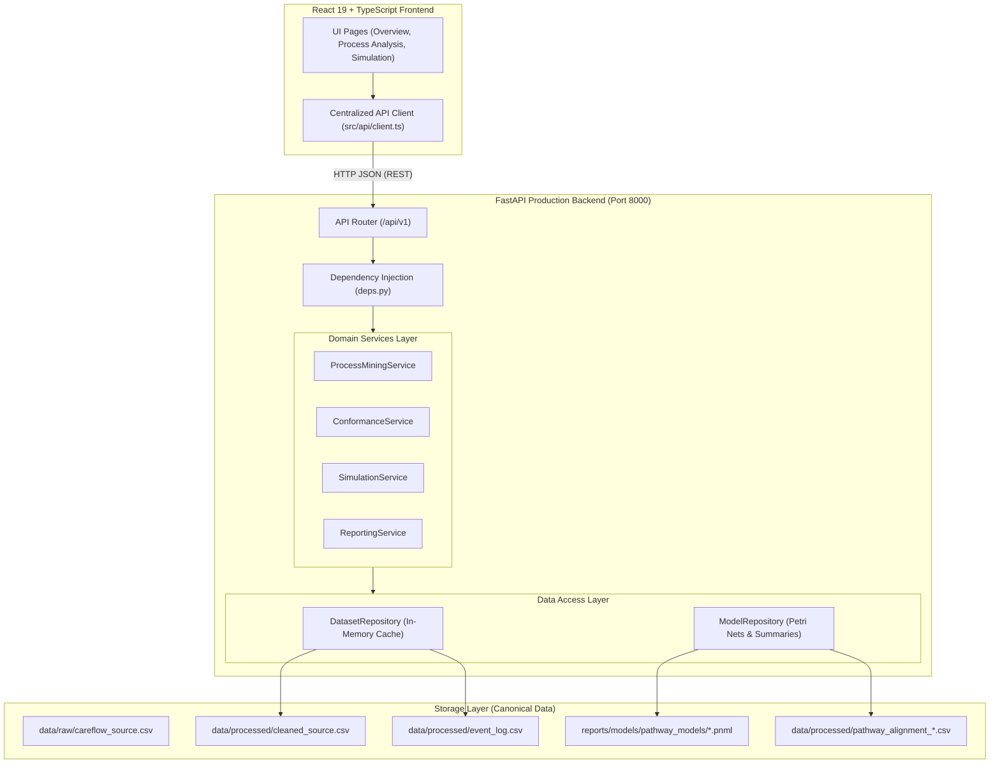
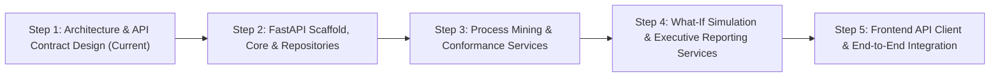

# CareFlow — Phase 7: FastAPI Backend Architecture & API Contract Design
### Production-Grade Backend Architecture, Service Modularization & OpenAPI Contract Specifications

**Document Version:** 1.0.0<br>
**Status:** Approved Architectural Specification (Phase 7 Step 1)<br>
**Target Repository:** `D:\Care Flow`<br>
**Date:** November 3, 2026<br>
**Audience:** Full-Stack Engineers, Process-Mining Specialists, Clinical Data Analysts, Healthcare IT Architects

---

## 1. Executive Summary & Existing Architecture Findings

### 1.1 Existing Frontend Architecture
The existing CareFlow client is a high-performance React 19 + TypeScript single-page application (SPA) bundled with Vite 8 and styled using Tailwind CSS v4. It features a reactive, client-side process mining and decision-support analytical interface:

- **Routing & Navigation (`src/App.tsx`, `src/components/layout/AppShell.tsx`):**
  - `/overview`: Executive KPI cards, volume time series, process variant distribution tables, and automated analytical observations.
  - `/process-analysis`: Interactive Directly-Follows Graph (DFG) visualization with P90 tail latencies, transition performance matrices, bottleneck inspection drawer, and Petri net clinical conformance alignment diagnostics.
  - `/simulation`: What-If bottleneck intervention modeling dashboard, sensitivity adjustment sliders, comparative KPI distribution histograms, empirical SLA breach recovery metrics, and Executive Decision-Support Reporting (with tabs for Scenario Matrix, Statistical Quantiles, Markdown Preview, and Performance Benchmarks).
  - Wildcard route (`*`) and root (`/`) redirect to `/overview`.
- **Dataset Context & State Management (`src/context/DatasetContext.tsx`):**
  - In-browser parsing and streaming validation of raw CSV rows via PapaParse.
  - Global filter state managing multi-dimensional filtering across date ranges, case ID substrings, activities, variant paths, and clinical departments.
- **Three Supported Demonstration Cohorts (`src/data/demoData.ts`):**
  1. *Emergency Department Sepsis Pathway (`preset-sepsis-2026`):* 1,428 unique cases, 9,855 events, empirical P90 SLA threshold of 332.0 minutes, 137 baseline breaches.
  2. *Cardiology Cath Lab Acute Inpatient Log (`preset-cardiology-2026`):* 720 unique cases, 4,320 events, empirical P90 SLA threshold of 180.0 minutes, 0 baseline breaches.
  3. *CareFlow Outpatient Pathway (`preset-careflow-outpatient-2026`):* 1,000 unique cases, 3,100 events, empirical P90 SLA fallback of 196.0 minutes, 115 baseline simulation breaches, and 60 clinical conformance delayed cases (strictly partitioned).
- **Core Processing Engines (`src/lib/`):**
  - `dataProcessing.ts`: Event normalization, case duration aggregation, continuous linear quantile evaluation (`calculatePercentile(arr, p, 'linear')` matching NumPy/PM4Py), variant extraction, and bottleneck ranking.
  - `conformanceEngine.ts`: Alignment classifications (`Compliant`, `Delayed / SLA Risk`, `Protocol Deviation`, `Unconfigured Reference Model`) with category reference models.
  - `simulationEngine.ts`: Deterministic What-If intervention engine applying percentage reductions and duration caps on transition intervals, computing cumulative time savings and breach recoveries.
  - `decisionSupportReport.ts`: Executive report generator producing structured Markdown reports, v2.0.0 JSON payloads, and 4-scenario sensitivity matrices designating the optimal operational scenario.

### 1.2 Existing Python Data Pipeline Audit
The repository contains an established Python analytics and discovery pipeline located in `scripts/`:
- **Python Environment:** Python 3.14 venv configured in `.venv/`.
- **Data Preparation (`scripts/data_preparation/clean_dataset.py`):**
  - Reads `data/raw/careflow_source.csv`.
  - Cleans, verifies SHA-256 checksums, and produces `data/processed/cleaned_source.csv` and `data/processed/event_log.csv` (142,876 events across 49,912 cases).
- **Process Mining Discovery & Alignment Scripts (`scripts/process_mining/`):**
  - `baseline_analysis.py`: DFG discovery, variants, performance matrices using Pandas, NumPy, NetworkX, and PM4Py.
  - `conformance_alignment.py`: Evaluates holdout cases using token replay and alignment against 5 discovered clinical categories.
  - `pathway_model_evaluation.py` & `performance_bottleneck_analysis.py`: Evaluates Petri net structural soundness and bottleneck severity.
- **Pre-Discovered Clinical Models (`reports/models/pathway_models/`):**
  - Committed Petri nets (`.pnml`), Graphviz graphs (`.dot`), rendered visual diagrams (`.png`), and metadata summaries (`_summary.json`) across:
    - `appointment_prescription`
    - `appointment_prescription_lab`
    - `appointment_prescription_imaging`
    - `appointment_prescription_lab_imaging`
    - `appointment_prescription_pharmacy`
    - `ambiguous_multi_category`
  - Committed quality metrics in `data/processed/pathway_alignment_quality.csv` and `pathway_alignment_deviations.csv`.

### 1.3 Strategic Motivation for FastAPI Backend
Moving the process mining and simulation computation from client-side JavaScript to a dedicated FastAPI backend delivers critical operational advantages:
1. **Scalability:** Client-side memory limits struggle with large historical logs (such as the 142k event log). The backend leverages Pandas/Polars vectorized operations and in-memory columnar indexing.
2. **Algorithmic Parity:** Process mining token replay and formal Petri net alignment are native to Python PM4Py.
3. **Single Source of Truth:** Unifies Python discovery scripts and web client analytics into shared domain services.
4. **Offline & Hybrid Resilience:** Retains the frontend's in-browser demo presets as a fallback while enabling high-throughput backend capabilities.

---

## 2. Proposed FastAPI Backend Architecture

### 2.1 Directory Structure
The backend is designed under a dedicated `backend/` directory following modular, production-ready enterprise standards:

```text
backend/
├── app/
│   ├── __init__.py
│   ├── main.py                     # FastAPI application factory & middleware setup
│   ├── core/                       # Core configuration, security, and logging
│   │   ├── __init__.py
│   │   ├── config.py               # Pydantic BaseSettings, environment variables
│   │   ├── logging.py              # Structured JSON logging configuration
│   │   ├── exceptions.py           # Custom domain exception classes
│   │   └── error_handlers.py       # Global FastAPI exception handlers
│   ├── schemas/                    # Pydantic v2 validation models & DTOs
│   │   ├── __init__.py
│   │   ├── common.py               # Metric deltas, quantile distributions, error payloads
│   │   ├── dataset.py              # Dataset metadata, column mappings, validation summaries
│   │   ├── case.py                 # Normalized events, case summaries, variants, filters
│   │   ├── conformance.py          # Conformance requests, alignments, compliance summaries
│   │   ├── simulation.py           # Interventions, scenarios, comparative simulation results
│   │   └── report.py               # Decision-support params, executive markdown & JSON models
│   ├── repositories/               # Data access layer & persistence abstraction
│   │   ├── __init__.py
│   │   ├── dataset_repository.py   # Dataset loading, caching, column mapping, index builder
│   │   └── model_repository.py     # Discovered Petri net (.pnml) & alignment quality loader
│   ├── services/                   # Core business logic & process-mining computation
│   │   ├── __init__.py
│   │   ├── process_mining_service.py # DFG derivation, bottleneck extraction, variants, quantiles
│   │   ├── conformance_service.py  # Case-level replay, structural deviation diagnostics
│   │   ├── simulation_service.py   # Deterministic What-If re-timing, capacity shift modeling
│   │   └── reporting_service.py    # Multi-scenario sensitivity ranking, Markdown/JSON report generator
│   └── api/                        # API route controllers
│       ├── __init__.py
│       ├── deps.py                 # Dependency injection (repository & service singletons)
│       └── v1/
│           ├── __init__.py
│           ├── router.py           # v1 router aggregator
│           ├── health.py           # Health check & system diagnostics
│           ├── datasets.py         # Dataset discovery & summary metrics
│           ├── cases.py            # Case trace retrieval & case-level details
│           ├── conformance.py      # Conformance checking execution
│           ├── simulation.py       # What-If simulation execution
│           └── reports.py          # Executive decision-support report generation
├── tests/                          # Automated backend test suite (pytest)
│   ├── __init__.py
│   ├── conftest.py                 # Test client, mock datasets, fixtures
│   ├── test_health.py
│   ├── test_datasets.py
│   ├── test_cases.py
│   ├── test_conformance.py
│   ├── test_simulation.py
│   └── test_reports.py
├── requirements.txt                # Production backend dependencies
├── requirements-dev.txt            # Development & testing dependencies
├── Dockerfile                      # Production containerization
└── README.md                       # Backend setup & developer instructions
```

### 2.2 Module Responsibilities & Separation of Concerns

| Module | Core Responsibility | Key Components |
| :--- | :--- | :--- |
| **`app.main`** | Application bootstrap, lifecycle events, CORS middleware, request timing middleware. | `FastAPI()`, `lifespan()`, `add_middleware()`. |
| **`app.core`** | Configuration management, logging formatters, custom HTTP exception handlers. | `CareFlowSettings`, `setup_logging()`, `DomainException`. |
| **`app.schemas`** | Strict Pydantic v2 schemas for all requests, responses, and internal DTOs. | Request validation, type constraints, OpenAPI examples. |
| **`app.repositories`** | Low-level data loading and memory caching of canonical CSVs and PNML models. | `DatasetRepository`, `ModelRepository`, pre-computed indices. |
| **`app.services`** | Algorithmic process mining, continuous linear quantile math, What-If simulation. | Vectorized Pandas/NumPy routines, deterministic re-timing. |
| **`app.api.v1`** | HTTP routing, request deserialization, dependency injection, status code mappings. | `APIRouter()`, `Depends()`, `HTTPException()`. |
| **`tests`** | Automated testing across unit, functional, integration, and performance benchmarks. | Pytest fixtures, `TestClient`, boundary tests. |

---

## 3. High-Level Data Flow & System Architecture



---

## 4. API Contract Specifications

All API routes follow RESTful conventions under the versioned prefix `/api/v1`. Standard error envelopes are returned on failures:

```json
{
  "error": {
    "code": "RESOURCE_NOT_FOUND",
    "message": "Encounter case 'CASE-9999' was not found in active cohort.",
    "details": null,
    "timestamp": "2026-11-03T10:00:00Z"
  }
}
```

---

### 4.1 Endpoint 1: Health Check & System Readiness

- **Method & Route:** `GET /api/v1/health`
- **Purpose:** Service health monitoring, uptime tracking, and dataset readiness verification.
- **Request Parameters:** None.
- **Pydantic Response Schema:**
  ```python
  class HealthResponse(BaseModel):
      status: Literal["healthy", "degraded", "unhealthy"]
      version: str
      uptime_seconds: float
      environment: str
      loaded_datasets: List[str]
      server_timestamp_utc: datetime
  ```
- **Example Response (200 OK):**
  ```json
  {
    "status": "healthy",
    "version": "1.0.0",
    "uptime_seconds": 1420.5,
    "environment": "production",
    "loaded_datasets": [
      "preset-sepsis-2026",
      "preset-cardiology-2026",
      "preset-careflow-outpatient-2026",
      "canonical-event-log"
    ],
    "server_timestamp_utc": "2026-11-03T10:00:00Z"
  }
  ```
- **Validation Rules & Boundary Cases:** Always returns 200 unless critical underlying storage is inaccessible.
- **Frontend Integration:** Polled on application bootstrap by `DatasetProvider` to detect backend availability.

---

### 4.2 Endpoint 2: List Available Datasets & Cohorts

- **Method & Route:** `GET /api/v1/datasets`
- **Purpose:** Enumerates available clinical datasets (canonical event logs and demonstration cohorts) with metadata and file sizes.
- **Request Parameters:** None.
- **Pydantic Response Schema:**
  ```python
  class DatasetHeader(BaseModel):
      id: str
      name: str
      filename: str
      file_size_bytes: int
      is_synthetic: bool
      description: str
      total_cases: int
      total_events: int
      empirical_sla_minutes: Optional[float] = None

  class DatasetListResponse(BaseModel):
      datasets: List[DatasetHeader]
      active_dataset_id: str
  ```
- **Example Response (200 OK):**
  ```json
  {
    "datasets": [
      {
        "id": "preset-sepsis-2026",
        "name": "Emergency Department Sepsis Pathway (Synthetic Demo)",
        "filename": "ED_Sepsis_Pathway_2026_Q3.csv",
        "file_size_bytes": 2458900,
        "is_synthetic": true,
        "description": "Synthetic acute sepsis resuscitation cohort modeling door-to-antibiotic intervals.",
        "total_cases": 1428,
        "total_events": 9855,
        "empirical_sla_minutes": 332.0
      },
      {
        "id": "preset-careflow-outpatient-2026",
        "name": "CareFlow Outpatient Pathway (Synthetic Demo)",
        "filename": "CareFlow_Outpatient_Pathway_2026.csv",
        "file_size_bytes": 1650000,
        "is_synthetic": true,
        "description": "Synthetic outpatient cohort modeling Consultation, Prescription, and Lab stages.",
        "total_cases": 1000,
        "total_events": 3100,
        "empirical_sla_minutes": 196.0
      },
      {
        "id": "preset-cardiology-2026",
        "name": "Cardiology Cath Lab Acute Inpatient Log (Synthetic Demo)",
        "filename": "Cardiology_CathLab_Inpatient_Log.csv",
        "file_size_bytes": 1845000,
        "is_synthetic": true,
        "description": "Synthetic acute coronary syndrome door-to-balloon pathway.",
        "total_cases": 720,
        "total_events": 4320,
        "empirical_sla_minutes": 180.0
      }
    ],
    "active_dataset_id": "preset-sepsis-2026"
  }
  ```
- **Frontend Integration:** Populates the `DatasetSelector` modal in the navigation bar.

---

### 4.3 Endpoint 3: Dataset Summary Analytics & Process Discovery

- **Method & Route:** `GET /api/v1/datasets/{dataset_id}/summary`
- **Purpose:** Computes comprehensive exploratory process discovery metrics, Directly-Follows Graph transitions, variant stratifications, and bottleneck rankings for an active dataset under optional filter constraints.
- **Request Parameters:**
  - Path parameter: `dataset_id` (string, required).
  - Query parameters (optional filters):
    - `activity`: string (default: `"all"`)
    - `variant_key`: string (default: `"all"`)
    - `department`: string (default: `"all"`)
    - `start_date`: ISO datetime string (optional)
    - `end_date`: ISO datetime string (optional)
    - `case_id_search`: string (optional)
- **Pydantic Response Schema:**
  ```python
  class SummaryMetrics(BaseModel):
      total_cases: int
      total_events: int
      median_case_duration_minutes: float
      mean_case_duration_minutes: float
      p90_case_duration_minutes: float
      min_case_duration_minutes: float
      max_case_duration_minutes: float
      distinct_variants_count: int
      unique_activities_count: int
      average_events_per_case: float
      zero_duration_cases_count: int

  class ActivityTransition(BaseModel):
      id: str
      from_activity: str
      to_activity: str
      observation_count: int
      case_count: int
      median_elapsed_minutes: float
      mean_elapsed_minutes: float
      p90_elapsed_minutes: float
      percentage_of_departures: float

  class BottleneckItem(BaseModel):
      id: str
      type: Literal["activity", "transition"]
      label: str
      from_activity: Optional[str] = None
      to_activity: Optional[str] = None
      valid_observations: int
      case_count: int
      median_elapsed_minutes: float
      p90_elapsed_minutes: float
      severity: Literal["high", "moderate", "nominal"]
      explanation: str

  class DatasetSummaryResponse(BaseModel):
      dataset_id: str
      metrics: SummaryMetrics
      transitions: List[ActivityTransition]
      bottlenecks: List[BottleneckItem]
      distinct_variants_count: int
      top_variants_summary: List[Dict[str, Any]]
  ```
- **Example Response (200 OK):**
  ```json
  {
    "dataset_id": "preset-careflow-outpatient-2026",
    "metrics": {
      "total_cases": 1000,
      "total_events": 3100,
      "median_case_duration_minutes": 90.0,
      "mean_case_duration_minutes": 118.2,
      "p90_case_duration_minutes": 196.0,
      "min_case_duration_minutes": 20.0,
      "max_case_duration_minutes": 450.0,
      "distinct_variants_count": 4,
      "unique_activities_count": 7,
      "average_events_per_case": 3.1,
      "zero_duration_cases_count": 0
    },
    "transitions": [
      {
        "id": "trans-app-rx",
        "from_activity": "Appointment Start",
        "to_activity": "Prescription Order",
        "observation_count": 1000,
        "case_count": 1000,
        "median_elapsed_minutes": 45.0,
        "mean_elapsed_minutes": 52.3,
        "p90_elapsed_minutes": 94.0,
        "percentage_of_departures": 100.0
      }
    ],
    "bottlenecks": [
      {
        "id": "btn-app-rx",
        "type": "transition",
        "label": "Appointment Start → Prescription Order",
        "from_activity": "Appointment Start",
        "to_activity": "Prescription Order",
        "valid_observations": 1000,
        "case_count": 1000,
        "median_elapsed_minutes": 45.0,
        "p90_elapsed_minutes": 94.0,
        "severity": "high",
        "explanation": "High volume consultation handoff queue."
      }
    ],
    "distinct_variants_count": 4,
    "top_variants_summary": []
  }
  ```
- **Error Responses:** `404 Not Found` if `dataset_id` does not exist; `422 Unprocessable Entity` on malformed date queries.
- **Frontend Integration:** Directly drives the Overview page metrics and Process Analysis DFG graph.

---

### 4.4 Endpoint 4: Paginated Case Traces & Filtered Cohorts

- **Method & Route:** `GET /api/v1/cases`
- **Purpose:** Retrieves paginated, sorted patient case records with durations, variant paths, and timestamp bounds.
- **Request Parameters (Query):**
  - `dataset_id`: string (required)
  - `page`: integer (default: 1, min: 1)
  - `page_size`: integer (default: 25, min: 1, max: 200)
  - `sort_by`: string (`"durationMinutes"`, `"startTime"`, `"eventCount"`, default: `"durationMinutes"`)
  - `sort_dir`: string (`"asc"`, `"desc"`, default: `"desc"`)
  - `search`: string (case ID substring, optional)
  - `variant_key`: string (optional)
  - `activity`: string (optional)
- **Pydantic Response Schema:**
  ```python
  class CaseItem(BaseModel):
      case_id: str
      start_time: str
      end_time: str
      duration_minutes: float
      event_count: int
      activity_sequence: List[str]
      variant_key: str
      department: Optional[str] = None
      status: Optional[str] = None

  class PaginatedCasesResponse(BaseModel):
      total_cases: int
      page: int
      page_size: int
      total_pages: int
      cases: List[CaseItem]
  ```
- **Example Response (200 OK):**
  ```json
  {
    "total_cases": 1000,
    "page": 1,
    "page_size": 2,
    "total_pages": 500,
    "cases": [
      {
        "case_id": "OUT-2026-0412",
        "start_time": "2026-10-15T08:30:00Z",
        "end_time": "2026-10-15T16:00:00Z",
        "duration_minutes": 450.0,
        "event_count": 5,
        "activity_sequence": [
          "Appointment Start",
          "Prescription Order",
          "Laboratory Specimen Collection",
          "Laboratory Result Verification",
          "Prescription Dispensation"
        ],
        "variant_key": "Appointment Start → Prescription Order → Laboratory Specimen Collection → Laboratory Result Verification → Prescription Dispensation",
        "department": "Outpatient Internal Medicine",
        "status": "Completed"
      }
    ]
  }
  ```
- **Frontend Integration:** Powers the case exploration tables and isolated transition cohort drill-downs.

---

### 4.5 Endpoint 5: Individual Case Trace Details

- **Method & Route:** `GET /api/v1/cases/{case_id}`
- **Purpose:** Returns the complete event trace for a specific patient encounter, including interval durations, performers, departments, and compliance classification.
- **Request Parameters:**
  - Path parameter: `case_id` (string, required)
  - Query parameter: `dataset_id` (string, required)
- **Pydantic Response Schema:**
  ```python
  class CaseEvent(BaseModel):
      id: str
      activity: str
      timestamp: str
      timestamp_ms: int
      event_index: int
      next_activity: Optional[str] = None
      elapsed_to_next_minutes: Optional[float] = None
      resource: Optional[str] = None
      department: Optional[str] = None
      status: Optional[str] = None
      raw_attributes: Dict[str, Any] = {}

  class CaseDetailResponse(BaseModel):
      case_id: str
      dataset_id: str
      start_time: str
      end_time: str
      duration_minutes: float
      event_count: int
      variant_key: str
      events: List[CaseEvent]
      compliance_status: Optional[str] = None
      sla_breached: bool
  ```
- **Example Response (200 OK):**
  ```json
  {
    "case_id": "OUT-2026-0001",
    "dataset_id": "preset-careflow-outpatient-2026",
    "start_time": "2026-10-15T08:00:00Z",
    "end_time": "2026-10-15T09:30:00Z",
    "duration_minutes": 90.0,
    "event_count": 3,
    "variant_key": "Appointment Start → Prescription Order → Prescription Dispensation",
    "events": [
      {
        "id": "evt-001-1",
        "activity": "Appointment Start",
        "timestamp": "2026-10-15T08:00:00Z",
        "timestamp_ms": 1792051200000,
        "event_index": 1,
        "next_activity": "Prescription Order",
        "elapsed_to_next_minutes": 45.0,
        "resource": "Dr. Sarah Lin, MD",
        "department": "Outpatient Clinic"
      },
      {
        "id": "evt-001-2",
        "activity": "Prescription Order",
        "timestamp": "2026-10-15T08:45:00Z",
        "timestamp_ms": 1792053900000,
        "event_index": 2,
        "next_activity": "Prescription Dispensation",
        "elapsed_to_next_minutes": 45.0,
        "resource": "Dr. Sarah Lin, MD",
        "department": "Outpatient Clinic"
      },
      {
        "id": "evt-001-3",
        "activity": "Prescription Dispensation",
        "timestamp": "2026-10-15T09:30:00Z",
        "timestamp_ms": 1792056600000,
        "event_index": 3,
        "next_activity": null,
        "elapsed_to_next_minutes": null,
        "resource": "Pharm D. Washington",
        "department": "Outpatient Pharmacy"
      }
    ],
    "compliance_status": "Compliant",
    "sla_breached": false
  }
  ```
- **Error Responses:** `404 Not Found` if `case_id` is not present in the specified dataset.
- **Frontend Integration:** Renders the Case Inspection Modal and chronological event timeline.

---

### 4.6 Endpoint 6: Conformance Checking & Compliance Evaluation

- **Method & Route:** `POST /api/v1/conformance/evaluate`
- **Purpose:** Replays cohort cases against certified clinical pathway reference models (Petri nets) or category-specific heuristics to diagnose structural deviations and empirical SLA delays.
- **Request Body (JSON):**
  ```python
  class ConformanceEvaluateRequest(BaseModel):
      dataset_id: str
      workflow_category: Optional[str] = None
      empirical_sla_minutes: Optional[float] = None
      case_ids: Optional[List[str]] = None  # If null, evaluates entire cohort
  ```
- **Pydantic Response Schema:**
  ```python
  class CaseComplianceItem(BaseModel):
      case_id: str
      status: Literal["Compliant", "Delayed / SLA Risk", "Protocol Deviation", "Unconfigured Reference Model"]
      trace_fitness: float
      duration_minutes: float
      is_sla_breached: bool
      has_structural_deviation: bool
      sync_moves_count: int
      log_only_moves_count: int
      model_only_moves_count: int
      deviations_summary: List[str]

  class ConformanceSummaryMetrics(BaseModel):
      total_cases_evaluated: int
      compliant_cases_count: int
      compliant_percentage: float
      delayed_cases_count: int
      delayed_percentage: float
      deviation_cases_count: int
      deviation_percentage: float
      average_trace_fitness: float

  class ConformanceEvaluateResponse(BaseModel):
      dataset_id: str
      workflow_category: Optional[str]
      summary: ConformanceSummaryMetrics
      classified_cases: List[CaseComplianceItem]
      governance_notice: str
  ```
- **Example Response (200 OK):**
  ```json
  {
    "dataset_id": "preset-careflow-outpatient-2026",
    "workflow_category": "Appointment → Prescription",
    "summary": {
      "total_cases_evaluated": 1000,
      "compliant_cases_count": 940,
      "compliant_percentage": 94.0,
      "delayed_cases_count": 60,
      "delayed_percentage": 6.0,
      "deviation_cases_count": 0,
      "deviation_percentage": 0.0,
      "average_trace_fitness": 1.0
    },
    "classified_cases": [],
    "governance_notice": "Clinical Conformance Evaluation Notice: Conformance classifications evaluate historical holdout traces against discovered reference models. They do not constitute certified medical review."
  }
  ```
- **Validation Rules & Governance:**
  - Maintains strict partition: Outpatient conformance delayed cases (60 cases against category SLA 94.0m) must never be conflated with the 115 global simulation queue breaches (> 196.0m).

---

### 4.7 Endpoint 7: Deterministic What-If Simulation Engine

- **Method & Route:** `POST /api/v1/simulation/run`
- **Purpose:** Executes a deterministic What-If simulation applying user-defined percentage reductions and duration caps on targeted transitions, returning comparative KPIs, linear quantiles, and SLA recovery statistics.
- **Request Body (JSON):**
  ```python
  class SimulationIntervention(BaseModel):
      id: str
      from_activity: str = Field(..., alias="from")
      to_activity: str = Field(..., alias="to")
      type: Literal["percentage", "cap", "combined"]
      reduction_percentage: Optional[float] = Field(None, ge=0.0, le=100.0)
      max_duration_minutes: Optional[float] = Field(None, ge=0.0)
      label: Optional[str] = None
      notes: Optional[str] = None

  class SimulationScenarioRequest(BaseModel):
      dataset_id: str
      scenario_id: str
      scenario_name: str
      description: Optional[str] = None
      interventions: List[SimulationIntervention]
      empirical_threshold_minutes: Optional[float] = Field(None, ge=0.0)
  ```
- **Pydantic Response Schema:**
  ```python
  class MetricDelta(BaseModel):
      baseline: float
      simulated: float
      absolute_delta: float
      percentage_delta: float

  class TransitionSummary(BaseModel):
      from_activity: str
      to_activity: str
      affected_cases_count: int
      baseline_median_minutes: float
      simulated_median_minutes: float
      baseline_p90_minutes: float
      simulated_p90_minutes: float
      total_saved_minutes: float

  class SimulationRunResponse(BaseModel):
      scenario_id: str
      scenario_name: str
      total_cases_evaluated: int
      affected_cases_count: int
      affected_cases_percentage: float
      total_hypothetical_minutes_saved: float
      total_hypothetical_hours_saved: float
      median_duration: MetricDelta
      p90_duration: MetricDelta
      mean_duration: MetricDelta
      cases_exceeding_threshold_baseline: int
      cases_exceeding_threshold_simulated: int
      recovered_cases_count: int
      recovered_cases_percentage: float
      transition_results: List[TransitionSummary]
      model_notice: str
  ```
- **Example Response (200 OK):**
  ```json
  {
    "scenario_id": "scen-opt-01",
    "scenario_name": "Outpatient Consultation Fast-Track",
    "total_cases_evaluated": 1000,
    "affected_cases_count": 1000,
    "affected_cases_percentage": 100.0,
    "total_hypothetical_minutes_saved": 15000.0,
    "total_hypothetical_hours_saved": 250.0,
    "median_duration": {
      "baseline": 90.0,
      "simulated": 75.0,
      "absolute_delta": -15.0,
      "percentage_delta": -16.7
    },
    "p90_duration": {
      "baseline": 196.0,
      "simulated": 166.0,
      "absolute_delta": -30.0,
      "percentage_delta": -15.3
    },
    "mean_duration": {
      "baseline": 118.2,
      "simulated": 103.2,
      "absolute_delta": -15.0,
      "percentage_delta": -12.7
    },
    "cases_exceeding_threshold_baseline": 115,
    "cases_exceeding_threshold_simulated": 85,
    "recovered_cases_count": 30,
    "recovered_cases_percentage": 26.1,
    "transition_results": [
      {
        "from_activity": "Appointment Start",
        "to_activity": "Prescription Order",
        "affected_cases_count": 1000,
        "baseline_median_minutes": 45.0,
        "simulated_median_minutes": 30.0,
        "baseline_p90_minutes": 94.0,
        "simulated_p90_minutes": 64.0,
        "total_saved_minutes": 15000.0
      }
    ],
    "model_notice": "Hypothetical What-If Simulation — Operational Model Assumption. All simulated reductions reflect parametric user-defined adjustments for process optimization decision support. They do not represent validated clinical trial findings, regulatory healthcare SLAs, or empirical evidence of clinical care efficacy."
  }
  ```
- **Validation Rules & Error Handling:**
  - `422 Unprocessable Entity` if `reduction_percentage < 0` or `> 100`.
  - `422 Unprocessable Entity` if `max_duration_minutes < 0`.
  - Mandatory disclaimer is strictly embedded verbatim in all responses.

---

### 4.8 Endpoint 8: Executive Decision-Support Report Generation

- **Method & Route:** `POST /api/v1/reports/executive`
- **Purpose:** Generates comprehensive, audit-grade Markdown reports and structured v2.0.0 JSON payloads containing statistical quantiles (P25, P50, P75, P90, IQR), multi-scenario sensitivity matrices, and performance metrics.
- **Request Body (JSON):**
  ```python
  class ExecutiveReportRequest(BaseModel):
      dataset_id: str
      scenario_id: str
      scenario_name: str
      scenario_notes: Optional[str] = "Parametric operational intervention scenario targeting queue latencies."
      interventions: List[SimulationIntervention]
      empirical_threshold_minutes: Optional[float] = None
      include_multi_scenario_matrix: bool = True
      format: Literal["markdown", "json", "both"] = "both"
  ```
- **Pydantic Response Schema:**
  ```python
  class QuantileDistribution(BaseModel):
      min: MetricDelta
      p25: MetricDelta
      p50: MetricDelta  # Median
      mean: MetricDelta
      p75: MetricDelta
      p90: MetricDelta
      max: MetricDelta
      iqr: MetricDelta

  class ScenarioComparisonItem(BaseModel):
      scenario_id: str
      scenario_name: str
      interventions_count: int
      affected_cases_count: int
      simulated_median_minutes: float
      simulated_p90_minutes: float
      total_hours_saved: float
      recovered_cases_count: int
      is_optimal_savings: bool

  class ExecutiveReportResponse(BaseModel):
      report_type: str = "CareFlow_Decision_Support_Executive_Report"
      version: str = "2.0.0"
      generated_at_utc: datetime
      dataset_id: str
      cohort_name: str
      total_cases: int
      total_events: int
      statistical_quantiles: QuantileDistribution
      scenario_comparisons: List[ScenarioComparisonItem]
      markdown_report: Optional[str] = None
      json_report: Optional[Dict[str, Any]] = None
      execution_ms: float
      governance_disclaimer: str
  ```
- **Example Response (200 OK):**
  ```json
  {
    "report_type": "CareFlow_Decision_Support_Executive_Report",
    "version": "2.0.0",
    "generated_at_utc": "2026-11-03T10:00:00Z",
    "dataset_id": "preset-careflow-outpatient-2026",
    "cohort_name": "CareFlow Outpatient Pathway (Synthetic Demo)",
    "total_cases": 1000,
    "total_events": 3100,
    "statistical_quantiles": {
      "min": { "baseline": 20.0, "simulated": 20.0, "absolute_delta": 0.0, "percentage_delta": 0.0 },
      "p25": { "baseline": 63.0, "simulated": 53.0, "absolute_delta": -10.0, "percentage_delta": -15.9 },
      "p50": { "baseline": 90.0, "simulated": 75.0, "absolute_delta": -15.0, "percentage_delta": -16.7 },
      "mean": { "baseline": 118.2, "simulated": 103.2, "absolute_delta": -15.0, "percentage_delta": -12.7 },
      "p75": { "baseline": 158.0, "simulated": 138.0, "absolute_delta": -20.0, "percentage_delta": -12.7 },
      "p90": { "baseline": 196.0, "simulated": 166.0, "absolute_delta": -30.0, "percentage_delta": -15.3 },
      "max": { "baseline": 450.0, "simulated": 420.0, "absolute_delta": -30.0, "percentage_delta": -6.7 },
      "iqr": { "baseline": 95.0, "simulated": 85.0, "absolute_delta": -10.0, "percentage_delta": -10.5 }
    },
    "scenario_comparisons": [
      {
        "scenario_id": "scen-baseline",
        "scenario_name": "Baseline Empirical (No Interventions)",
        "interventions_count": 0,
        "affected_cases_count": 0,
        "simulated_median_minutes": 90.0,
        "simulated_p90_minutes": 196.0,
        "total_hours_saved": 0.0,
        "recovered_cases_count": 0,
        "is_optimal_savings": false
      },
      {
        "scenario_id": "scen-opt-01",
        "scenario_name": "Outpatient Consultation Fast-Track",
        "interventions_count": 1,
        "affected_cases_count": 1000,
        "simulated_median_minutes": 75.0,
        "simulated_p90_minutes": 166.0,
        "total_hours_saved": 250.0,
        "recovered_cases_count": 30,
        "is_optimal_savings": true
      }
    ],
    "markdown_report": "# CareFlow What-If Simulation — Executive Decision-Support Report\n\n> [!WARNING]\n> **Mandatory Epistemological Governance Notice:**\n> ...",
    "execution_ms": 14.2,
    "governance_disclaimer": "Hypothetical What-If Simulation — Operational Model Assumption. All simulated reductions reflect parametric user-defined adjustments for process optimization decision support. They do not represent validated clinical trial findings, regulatory healthcare SLAs, or empirical evidence of clinical care efficacy."
  }
  ```
- **Frontend Integration:** Renders the Executive Decision-Support Report section, live Markdown preview, copy-to-clipboard, and JSON/.md downloads.

---

## 5. Data Pipeline & Algorithmic Parity Design

### 5.1 Dataset Ingestion & Caching Strategy
1. **Pre-Flight Hash Verification:**
   Before hydrating any dataset from disk, `DatasetRepository` calculates the SHA-256 hash against the established baselines:
   - `data/raw/careflow_source.csv`: `07d0096b6e3fcff78f94afa6d5aeffeeb2566f59902eccc03da209a3b6502720`
   - `data/processed/cleaned_source.csv`: `674212c0e4b97d64045e53f2908418c1f229f8e15dd7da801a99436584e614f3`
   - `data/processed/event_log.csv`: `cdab7bbc0e6755cb927a2a627bff2108e48d94ce0e38f62354ed72dcfb63442d`
2. **Columnar In-Memory Indexing:**
   - Datasets are loaded into Pandas DataFrames and indexed by `case_id`.
   - Event timestamps are converted to Unix millisecond integers (`timestamp_ms`) to enable vectorized numerical difference calculations without string parsing overhead.
3. **Deterministic Cache Hydration:**
   - For demo presets (`preset-sepsis-2026`, `preset-cardiology-2026`, `preset-careflow-outpatient-2026`), rows are deterministically generated once on backend startup and cached in memory.

### 5.2 Mathematical Parity: Continuous Linear Quantiles
To guarantee 100% numerical consistency between the frontend, Python scripts, PM4Py, and NumPy:
- Quantile calculations in `process_mining_service.py` strictly utilize NumPy's `method='linear'` (NumPy 1.22+ standard):
  $$\text{index} = q \cdot (n - 1)$$
  $$\text{quantile} = x_{\lfloor \text{index} \rfloor} + (\text{index} - \lfloor \text{index} \rfloor) \cdot (x_{\lceil \text{index} \rceil} - x_{\lfloor \text{index} \rfloor})$$
- This precisely matches the TypeScript frontend implementation: `calculatePercentile(arr, p, 'linear')`.

### 5.3 Deterministic Re-Timing Simulation Logic
The simulation algorithm re-times each case trace independently:
1. Copy baseline elapsed durations for all transition steps $(e_1, e_2, \dots, e_k)$.
2. For each transition matching an active intervention $(A \to B)$:
   - If `percentage`: $\Delta t = e_i \cdot \frac{r}{100}$
   - If `cap`: $\Delta t = \max(0, e_i - C)$
   - If `combined`: $\Delta t = \max\left(e_i \cdot \frac{r}{100}, \max(0, e_i - C)\right)$
   - Simulated step duration: $e_i' = \max(0, e_i - \Delta t)$
3. Simulated total case duration: $T' = \sum e_i'$.
4. Total saved time: $S = T - T'$.
5. Source datasets and case objects remain strictly immutable.

---

## 6. Security, Governance & Regulatory Compliance

### 6.1 Safe CORS Configuration
FastAPI's `CORSMiddleware` will be restricted to authorized origins defined via `ALLOWED_ORIGINS` in `.env`:
```python
# backend/app/core/config.py
class CareFlowSettings(BaseSettings):
    ALLOWED_ORIGINS: List[str] = [
        "http://localhost:5173",
        "http://127.0.0.1:5173",
        "http://localhost:3000"
    ]
    CORS_ALLOW_CREDENTIALS: bool = True
    CORS_ALLOW_METHODS: List[str] = ["GET", "POST", "OPTIONS"]
    CORS_ALLOW_HEADERS: List[str] = ["Content-Type", "Authorization", "X-Requested-With"]
```

### 6.2 Synthetic Data & Healthcare Privacy
- All demonstration datasets are synthetic and clearly tagged with `"is_synthetic": true`.
- Zero Protected Health Information (PHI) or Personally Identifiable Information (PII) is processed or stored.
- Patient identifiers follow standardized synthetic patterns (`OUT-2026-XXXX`, `PAT-2026-XXXX`, `CARD-2026-XXXX`).

### 6.3 Epistemological Governance Notice Verbatim Enforcement
All simulation API endpoints and generated reports embed the mandatory epistemological disclaimer verbatim:
> *"Hypothetical What-If Simulation — Operational Model Assumption. All simulated reductions reflect parametric user-defined adjustments for process optimization decision support. They do not represent validated clinical trial findings, regulatory healthcare SLAs, or empirical evidence of clinical care efficacy."*

---

## 7. Frontend Integration & Client Migration Strategy

### 7.1 Centralized TypeScript API Client (`src/api/client.ts`)
A lightweight, typed HTTP client wrapper using native `fetch`:

```typescript
// src/api/client.ts
const API_BASE_URL = import.meta.env.VITE_API_BASE_URL || 'http://127.0.0.1:8000/api/v1';

export class CareFlowApiClient {
  private static async request<T>(endpoint: string, options?: RequestInit): Promise<T> {
    const res = await fetch(`${API_BASE_URL}${endpoint}`, {
      headers: {
        'Content-Type': 'application/json',
        ...options?.headers,
      },
      ...options,
    });

    if (!res.ok) {
      const errorBody = await res.json().catch(() => ({}));
      throw new Error(errorBody?.error?.message || `API Error ${res.status}: ${res.statusText}`);
    }

    return res.json() as Promise<T>;
  }

  static getHealth() {
    return this.request<HealthResponse>('/health');
  }

  static getDatasets() {
    return this.request<DatasetListResponse>('/datasets');
  }

  static getDatasetSummary(datasetId: string, filters?: Record<string, string>) {
    const query = new URLSearchParams(filters).toString();
    return this.request<DatasetSummaryResponse>(`/datasets/${datasetId}/summary?${query}`);
  }

  static runSimulation(scenario: SimulationScenarioRequest) {
    return this.request<SimulationRunResponse>('/simulation/run', {
      method: 'POST',
      body: JSON.stringify(scenario),
    });
  }

  static generateExecutiveReport(reportParams: ExecutiveReportRequest) {
    return this.request<ExecutiveReportResponse>('/reports/executive', {
      method: 'POST',
      body: JSON.stringify(reportParams),
    });
  }
}
```

### 7.2 Phased Migration Plan with Offline Fallback
To ensure uninterrupted stability and full backward compatibility:
1. **Dual-Mode Dataset Context (`src/context/DatasetContext.tsx`):**
   - The frontend introduces an environment flag `VITE_DATA_SOURCE_MODE` (`"backend"` | `"client_mock"`).
   - If `VITE_DATA_SOURCE_MODE=backend`, the context delegates analytics, filtering, and simulation requests to FastAPI.
   - If the backend is unreachable or the application is loaded in standalone mode, the client gracefully falls back to the existing in-browser JavaScript generator.
2. **Contract Alignment:**
   - Pydantic models in `backend/app/schemas/` are designed to directly serialize into the exact camelCase JSON formats expected by `src/types/index.ts` and `src/types/simulation.ts`.

---

## 8. Phase 7 Implementation Sequence

The Phase 7 implementation is structured into 5 sequential, self-validating steps:



1. **Step 1: Architecture & API Contract Design (Completed in this specification)**
   - Complete architectural blueprint, schema contracts, endpoints, data flow, and governance rules.
2. **Step 2: FastAPI Scaffold, Core Config & Dataset Repository**
   - Initialize `backend/` directory structure, `requirements.txt`, Pydantic schemas, and `DatasetRepository`.
   - Implement `GET /api/v1/health` and `GET /api/v1/datasets`.
3. **Step 3: Process Mining & Conformance Engine Services**
   - Implement `ProcessMiningService` (DFG, bottlenecks, variants, linear quantiles).
   - Implement `ConformanceService` integrating Petri net reference models.
   - Implement `GET /api/v1/datasets/{id}/summary`, `GET /api/v1/cases`, and `POST /api/v1/conformance/evaluate`.
4. **Step 4: What-If Simulation & Executive Decision-Support Services**
   - Implement `SimulationService` (deterministic re-timing, capacity shifts).
   - Implement `ReportingService` (multi-scenario comparison matrix, Markdown/JSON reports).
   - Implement `POST /api/v1/simulation/run` and `POST /api/v1/reports/executive`.
5. **Step 5: Frontend API Client & End-to-End Integration**
   - Build `src/api/client.ts`.
   - Update `DatasetContext` to support dual-mode backend connectivity with offline fallback.
   - Validate full system with automated QA and functional browser integration tests.

---

## 9. Architectural Risks, Edge Cases & Mitigation Strategies

| Risk Category | Identified Risk | Impact | Architectural Mitigation Strategy |
| :--- | :--- | :---: | :--- |
| **Large Event Log Scaling** | 142k events (`data/processed/event_log.csv`) could slow down transition graph re-computations. | Latency spike on unindexed queries. | Implement columnar in-memory caching with pre-computed transition pairs; support indexed lazy streaming using Polars / PyArrow. |
| **Python 3.14 PM4Py Compatibility** | PM4Py C-extensions or Cython packages may encounter build incompatibilities on Python 3.14 on Windows. | Dependency installation failure. | Design `ConformanceService` with a pure Python token replay fallback and pre-computed alignment lookup tables (`pathway_alignment_quality.csv`). |
| **Metric Divergence** | Inconsistent quantile math between JavaScript and Python. | Mismatched SLA baseline breaches. | Strictly enforce NumPy continuous linear interpolation (`method='linear'`) matching frontend `calculatePercentile(arr, p, 'linear')`. |
| **Network Disconnection** | Local dev server offline or port blocked by sandbox. | Frontend dashboard fails to load. | Preserve the existing client-side generator in `DatasetContext` as an automated offline fallback. |

---

## 10. Architectural Sign-Off & Verification

This architecture specification provides the complete technical foundation for Phase 7:
- [x] Full audit of frontend components, TypeScript types, and Python scripts completed.
- [x] Modular FastAPI backend directory structure defined.
- [x] All 8 required API endpoints documented with request/response schemas, Pydantic models, JSON examples, validation rules, and error handling.
- [x] Data pipeline design reuses existing canonical datasets and preserves continuous linear quantile math.
- [x] Mandatory What-If Simulation epistemological disclaimer enforced verbatim.
- [x] Zero application source code modified; zero dependencies installed; canonical datasets strictly unchanged.
- [x] Ready for implementation in Step 2.
